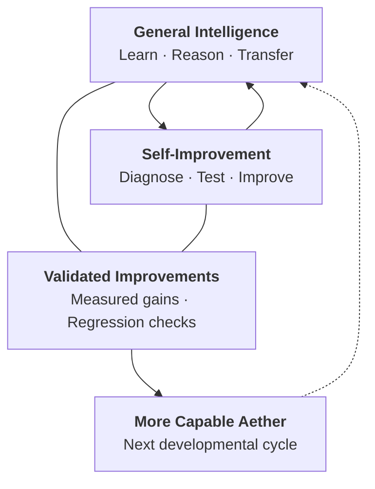

# Aether Vision: AGI and RSI

*The intended architecture: intelligence supports improvement, and validated improvement expands intelligence.*

## The objective

> Aether is a persistent, general-purpose cognitive architecture designed to acquire knowledge, construct new
> capabilities, identify its own limitations, and recursively improve its learning and reasoning mechanisms through
> independently validated experience.

Its improvements should be tested in isolation, checked for regressions, and integrated through controlled
mechanisms rather than unrestricted self-modification.

**The scientific measure:** does Aether become more capable on previously unseen problems, and does it eventually
become more effective at producing those improvements?

## Two parts, one system

**AGI is what Aether can do. RSI is how Aether becomes increasingly capable of doing it.**

- **General intelligence (learn · reason · transfer):** learn unfamiliar domains, reason across different problems,
  transfer knowledge, adapt to new environments, and solve tasks it was never specifically programmed to solve.
- **Recursive self-improvement (diagnose · test · improve):** examine its own performance, identify limitations,
  propose improvements to its learning or reasoning mechanisms, test those improvements, and eventually become better
  at performing that improvement process itself.
- **Validated improvements (measured gains · regression checks)** feed the next developmental cycle: a more capable
  Aether.

The recursive part begins when Aether improves its ability to improve itself. Simply learning more facts, building
more concepts, or installing a human-designed component isn't sufficient to demonstrate RSI.

## What it looks like in practice (from T291)

Aether notices its failure on unfamiliar mathematical sequences. It tests whether basic mathematical concepts would
help, discovers that they cover almost none of its failures, and decides not to waste resources pursuing that
hypothesis. Then it identifies a more promising limitation, designs another experiment, and validates a solution.

Eventually that process extends beyond knowledge acquisition to improving Aether's own reasoning algorithms,
representations, memory management and learning strategies.

The milestone is not Aether saying "I need to learn mathematics". It is Aether saying "I considered learning
mathematics, tested whether that would help, found insufficient evidence, and chose a better experiment instead."

## Ambition vs. evidence (as of 2026-11-02)

**What the experiments support:**
- Bounded learning.
- Procedural composition.
- Substantial gains from practice.
- Hidden-state world learning: T287, T290.
- Doubt and asking: T279.

**What they do not yet establish:**
- General intelligence.
- Recursive architectural self-improvement.

So far, Claude has done the diagnosing (for example the T291 reach pre-check). The next step is moving that diagnosis
into Aether: board task T291, self-diagnosis by reach, scored by diagnostic regret and wasted effort on unseen tasks.
